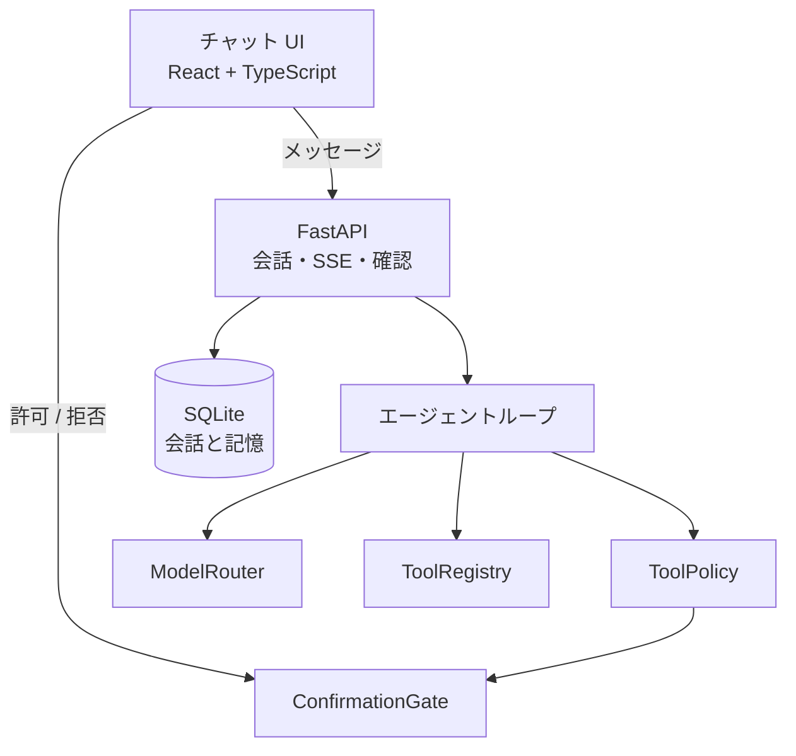
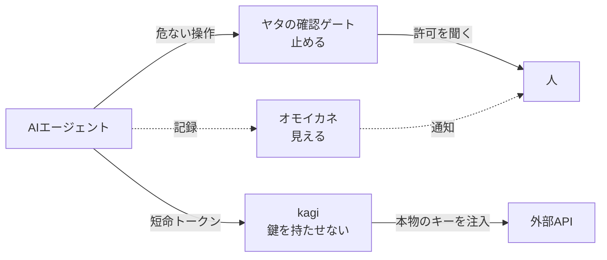

## はじめに

ZEN大学で知能情報を学んでいる2年生の松延です。AIエージェントを作る・使う側のエンジニアを目指して、個人開発をしています。

2026年10月、AIエージェントまわりのOSSを3つ作りました。

| 名前 | ひとことで | 言語 |
| --- | --- | --- |
| **ヤタ（Yata）** | 自分のPCで動く、日本語ファーストの個人AIアシスタント | Python / TypeScript |
| **kagi（鍵）** | AIエージェントに本物のAPIキーを持たせないシークレット・ブローカー | Go |
| **オモイカネ（omoikane）** | Claude Code の動きを、やさしい日本語でひと目で見せる画面 | TypeScript |

バラバラに作ったように見えますが、作り終えてみると同じ問いに答えようとしていました。

> **AIエージェントに、安心して仕事を任せるには何が要るか？**

自分なりの答えは次の3つです。

1. **危ない操作の前で止める**（ヤタの確認ゲート）
2. **そもそも鍵を持たせない**（kagi）
3. **何をしているかが見える**（オモイカネ）

この記事では、3つそれぞれの設計で考えたことと、作って分かったことをまとめます。

:::message
3つとも、Claude Code（VS Code 拡張）と相談しながら開発しています。設計の方向や「何を作るか・作らないか」は自分で決め、実装はAIと二人三脚、という進め方です。
:::

---

## 1. ヤタ：止まれるエージェントを作る

https://github.com/koheip/yata

### どんなものか

ヤタは、チャットで話しかけると、Web検索・ページ読解・ブラウザ操作・Gmail/カレンダー・LINE などを使って仕事を手伝う AI アシスタントです。名前は神武天皇を導いた八咫烏（やたがらす）から取りました。

特徴は次のとおりです。

- **ローカルで動く**：会話や記憶は PC の SQLite に保存
- **AIを選べる**：Gemini / OpenAI / Anthropic / xAI / DeepSeek など、さらに Ollama・LM Studio などのローカルLLMにも対応
- **日本のサービスとつながる**：Chatwork、Backlog、kintone、freee、マネーフォワード クラウド請求書、楽天市場、LINE
- **日本の仕事の計算**：祝日・営業日・和暦、インボイスの消費税
- **ルーティン**：「毎朝8時にニュースを要約して」とチャットで頼むと、APScheduler で毎日実行
- **完全オフラインモード**：ローカルLLMだけを使い、ネットに出るツールをすべて止める

### アーキテクチャ



バックエンドは Python（FastAPI）、画面は React + TypeScript です。エージェントループ・Playwright・SQLite を同じプロセスに置き、途中経過（`tool_call` / `tool_result` / `confirmation_required` など）は Server-Sent Events で画面に流しています。

### 工夫1：ツールに「リスク」を持たせ、ループは聞くだけにする

ツールは「名前・JSON Schema・リスク・実行関数」を持つクラスです。リスクは4段階にしました。

| Risk | 例 | 扱い |
| --- | --- | --- |
| `read` | 検索、ページ読解、Gmail の参照 | すぐ実行 |
| `write` | ローカルの記憶保存、メールの下書き | すぐ実行 |
| `mutate` | ブラウザのクリック・入力 | **確認してから** |
| `external` | メール送信、予定の作成・削除、決済 | **確認してから** |

エージェントループは「このツールは確認が要るか？」を `ToolPolicy` に聞くだけで、ツールごとの特別扱いを書きません。新しい危ないツールを足すときも、`Risk.EXTERNAL` を付けて登録すれば同じ確認の流れに乗ります。

確認ゲートは、`asyncio.Future` で「エージェントのループ」と「画面からの許可リクエスト」をつないでいます。

```python
class InMemoryConfirmationGate:
    def __init__(self) -> None:
        self._pending: dict[str, asyncio.Future[bool]] = {}

    def open(self) -> str:
        request_id = uuid.uuid4().hex
        self._pending[request_id] = asyncio.get_running_loop().create_future()
        return request_id

    async def wait(self, request_id: str, timeout: float) -> bool:
        future = self._pending.get(request_id)
        if future is None:
            return False
        try:
            return await asyncio.wait_for(future, timeout)
        except TimeoutError:
            return False  # 時間切れは「拒否」扱い
        finally:
            self._pending.pop(request_id, None)

    def resolve(self, request_id: str, approved: bool) -> bool:
        future = self._pending.get(request_id)
        if future is None or future.done():
            return False
        future.set_result(approved)
        return True
```

時間切れは「拒否」に倒しています。迷ったら実行しない、という方針です。

ルーティン（誰も画面を見ていないとき）から危ないツールが呼ばれた場合は、勝手に実行せず「確認待ち」で止まり、次に画面を開いたときに許可・拒否を聞きます。LINE から使うときは、メッセージに「許可する」「拒否する」ボタンが出ます。

### 工夫2：LLMのラッパーを使わず、公式SDKで差を見えるところに置く

モデルの差し替えには LiteLLM のような統一ラッパーも検討しましたが、今回は公式SDK（`google-genai`、`openai`、`anthropic`）を直接使いました。

プロバイダのインターフェースは `complete(messages, tools, model)` の1つだけ。各社の違い、特に **ツール結果の返し方の違い** は `convert.py` 1か所に閉じ込めています。

- OpenAI：`tool` ロールのメッセージ
- Anthropic：`tool_result` ブロック
- Gemini：`function_response` パート

ラッパーを使えばコードは減りますが、依存が増え、「どこで何が変換されているか」が見えにくくなります。学習とポートフォリオを兼ねた個人開発なので、違いが読める方を選びました。Ollama などの OpenAI 互換サーバーは `base_url` を変えるだけで動きます。

### 工夫3：外に出る入口を最小にする

- ページ読解はリダイレクトのたびに URL を検査し、クラウドのメタデータ（`169.254.169.254` など）は常に拒否
- LINE の Webhook は、メイン画面（8741番）とは別のサーバー（8742番）で `/line/webhook` だけを公開。署名検証と userId の許可リストで受信を絞る
- cloudflared のトンネルはヤタが自動で立ち上げ、URL が変わるたびに LINE 側の Webhook URL を登録し直す

### 作ってみて：設定が大変すぎた

v0.1.0 を公開し、自分で毎日使ってみたところ、いちばんの問題は機能ではなく **設定の大変さ** でした。特に Google 連携（Cloud Console で OAuth クライアントを作る）と LINE 連携（公式アカウント・チャネル・Webhook）は、手順が多すぎて一般の人にはまず無理です。

API キーをアプリ内で貼れるようにする、インストールを1行にする、LINE のトンネルを自動化する、と少しずつ減らしてきましたが、「連携先が増えるほど設定が増える」という構造は残っています。ここは次の課題です。

---

## 2. kagi：エージェントに鍵を持たせない

https://github.com/koheip/kagi

### なぜ作ったか

ヤタを作っていて気になったのが、**APIキーの渡し方** です。LLMエージェントに長期のAPIキーを環境変数で渡すと、悪意あるWebページやメールを読んだだけで、プロンプトインジェクションによってキーが外に送られるおそれがあります。

そこで、エージェントとAPIの間に立つブローカー **kagi** を Go で作りました。エージェントが持つのは **mTLS のクライアント証明書** と **数分で失効するトークン** だけ。本物のキーは、kagi が通信のときに注入します。

```
 AI Agent ──mTLS + 短命トークン──▶ kagid ──HTTPS + 本物のキー──▶ OpenAI など
 (キーを知らない)                    │ トークン検証・許可リスト
                                    │ 回数上限・SSRF防止
                                    │ レスポンスの伏字化
                                    └─ ハッシュチェーン監査ログ
```

依存ライブラリはゼロ（Go 標準ライブラリのみ）で、サプライチェーン攻撃の面を小さくしています。

### OWASP Top 10 for LLM との対応

設計は、最近の課題に1つずつ対策を当てる形で考えました。

| 課題 | kagi の対策 |
| --- | --- |
| プロンプトインジェクションでの秘密の流出（LLM01/02） | エージェントはキーを知らない。上流がキーをエコーしても伏字化 |
| 過剰な権限（LLM06） | メソッド＋パス単位の許可リスト（デフォルト拒否） |
| 無制限な消費（LLM10） | トークンごとの回数上限、エージェントごとのレート制限 |
| トークンの盗難 | トークンをクライアント証明書に紐付け（RFC 8705 の考え方） |
| SSRF / DNSリバインディング | 名前解決 **後** の実IPでプライベート宛を遮断 |
| Harvest now, decrypt later | TLS 1.3 で X25519MLKEM768（ML-KEM のハイブリッド）を優先 |
| 監査ログの改ざん | HMAC のハッシュチェーンで1文字の改ざんも検知 |

### 工夫1：トークンを証明書に縛る

トークンは Ed25519 で署名し、中にクライアント証明書の SHA-256 サムプリント（`cnf` クレーム）を入れています。トークンがログなどから漏れても、別の証明書を持つエージェントからは使えません。

```
== トークンを盗んだ別エージェントが使う → 401（証明書バインド）
{"error":"token not bound to this client certificate"}
```

### 工夫2：チャンク境界をまたぐ伏字化

上流APIのレスポンスに本物のキーが混ざってしまったとき（エラーメッセージでのエコーなど）に備えて、kagi はレスポンスからキーを伏字にします。

難しかったのは **ストリーミング** です。SSE のレスポンスは細切れに届くので、キーが2つのチャンクにまたがると、単純な置換では見逃します。そこで「キーの長さ − 1 バイト」だけを次の読み込みまで持ち越し、境界をまたぐ一致も検出できるようにしました。

```go
mask(r.pend, r.secret)
keep := len(r.secret) - 1   // 境界をまたぐかもしれない分は持ち越す
if r.eof {
    keep = 0
}
if len(r.pend) > keep {
    cut := len(r.pend) - keep
    r.out = append([]byte(nil), r.pend[:cut]...)
    r.pend = append([]byte(nil), r.pend[cut:]...)
}
```

テストでは `iotest.OneByteReader` で1バイトずつ読ませ、最悪の分割でも漏れないことを確かめています。また、圧縮されたレスポンスでは一致を検出できないため、上流には `Accept-Encoding: identity` を強制しています。

### 工夫3：保存時の暗号化と「失敗したら止まる」

- 秘密は **エンベロープ暗号化**：パスフレーズ →（PBKDF2-SHA256 60万回 → HKDF）→ KEK、秘密ごとに DEK（AES-256-GCM）。秘密の名前を AAD に入れ、暗号文の入れ替えを検知
- パスフレーズの変更は DEK を包み直すだけで、秘密の暗号文は変わらない
- **フェイルクローズ**：監査ログに書けなければ、リクエストを実行しない
- ポリシーの未知フィールドは読み込みエラー（タイプミスで権限が広がる事故を防ぐ）

デモスクリプト（`./scripts/demo.sh`）を実行すると、CA の発行から攻撃シナリオ（キーのエコー、トークン盗難、監査ログの改ざん）までを一通り確かめられます。

### 使う側はほぼ変わらない

エージェント側は、OpenAI SDK の `base_url` と証明書を差し替えるだけです。

```python
client = OpenAI(
    base_url="https://localhost:8443/v1/proxy/openai/v1",
    api_key=token,  # kagi の短命トークン（本物のキーではない）
    http_client=httpx.Client(cert=("pki/yata.crt", "pki/yata.key"), verify="pki/ca.crt"),
)
```

---

## 3. オモイカネ：エージェントの動きを見えるようにする

### 最初はオーケストレーターだった

オモイカネは、最初は **AIエージェントのオーケストレーター** として作り始めました。Claude Code を「実装係 → テスト係 → テスト実行 → レビュー係」に分け、司令塔が仕事を割り振ります。名前は、天岩戸の神話で神々に役目を割り振った知恵の神・思金神（おもいかねのかみ）から取りました。

この段階で入れたのは次のような仕組みです。

- 係は `claude -p --output-format stream-json` で動かし、出力を1行ずつ読んで共通のイベントに変換
- テストの合否は **係の自己申告ではなく、オモイカネが自分でテストコマンドを実行して判定**
- テストやレビューで落ちたら、上限回数まで実装係に差し戻し
- 係は git worktree の専用ブランチで動くので、手元の作業を壊さない
- マージの前は、人が「許可」を押すまで必ず止まる
- 係の中身は Claude のほか、ChatGPT / Grok / DeepSeek / Gemini にも切り替え可能

### 方向転換：いちばんわくわくしたのは「見える画面」だった

ところが作っているうちに、「自分は実務でこのオーケストレーターを使うだろうか？」と疑問がわきました。係に分けた方が本当に良いのかは、評価してみないと分かりません。

一方で、作っていていちばん楽しかったのは、**エージェントの動きがリアルタイムで流れていく画面** でした。そこで方針を変え、**ふだん使っている Claude Code のセッション記録を横から読んで見せる「見守り画面」** をメインにしました。

```bash
npm run watch        # ふだんの Claude Code を見守る → http://localhost:4318
npm run watch:demo   # Claude Code なしで試す
```

オモイカネは `~/.claude/projects` の JSON Lines を読むだけで、Claude Code にも記録にも何も書き込みません。

画面で分かることは次のとおりです。

- **いま**：作業中・考え中・あなたの番・止まっている、と「ファイルを書き換えています：src/app.ts」のような一文
- **セッション一覧**：複数のセッションを1画面で見渡せる
- **トークンと費用**：入力・出力・キャッシュの内訳と、サブエージェントごとの数
- **触ったファイル・実行したコマンド**：読み書きの回数、コマンドの成否
- **通知**：あなたの番になった、質問が来た、止まっているかもしれない、とき

### 工夫1：fs.watch を使わず、追記分だけを読む

ファイルの変更検知は `fs.watch` が OS によって当てにならないので、1秒ごとのポーリングにしました。ファイルごとに読んだ位置（オフセット）を覚えておき、**書き足された行だけ** を読みます。大きなファイルは最初に末尾の 8MB だけを読み、切れた最初の行は捨てます。

記録の形式は Claude Code のバージョンで少しずつ変わるので、**知らない行は黙って読み飛ばす** ようにしています。

### 工夫2：トークンの二重カウントを防ぐ

トークン数の表示では、ストリームの性質にハマりました。同じメッセージの `usage` は何度も届き、しかも `output_tokens` は累積値です。単純に足すと、何倍にも膨らみます。

そこで、**メッセージIDごとに最新（最大）の値だけを持ち、それを足し合わせる** ようにしました。実行が終わったら、結果イベントの `modelUsage`（裏で使われた小さいモデルの分も含む）で答え合わせをします。

```typescript
export class TokenMeter {
  private perMessage = new Map<string, Usage>();

  observe(messageId: string, raw: RawUsage | undefined | null): void {
    if (!messageId || !raw) return;
    const prev = this.perMessage.get(messageId) ?? ZERO_USAGE;
    // 足さずに最大値を取る（output_tokens は累積値なので）
    this.perMessage.set(messageId, maxUsage(prev, fromRaw(raw)));
  }
  // 終了時は modelUsage で答え合わせ
}
```

### 工夫3：「止まっているかも」は推測だと正直に書く

Claude Code の記録には、許可待ちかどうかが直接書かれていません。そこで、道具の結果がコマンドで45秒、ほかで20秒返ってこないときに「許可を待っているか、時間のかかる処理かもしれません」と表示しています。推測であることは画面と README に明記しました。

---

## 3つをつなぐと

最初の問いに戻ると、3つは次のように役割を分けています。



- **止める**：危ない操作の前で、人に聞く
- **持たせない**：エージェントが盗まれて困るものを、そもそも持たせない
- **見える**：何が起きているかを、人がすぐ分かる

どれか1つだけでは足りず、組み合わせて初めて「任せられる」に近づく、というのが作ってみての実感です。

## 作って学んだこと

- **安全は「既定値」で決まる**：時間切れは拒否、未知のフィールドはエラー、監査ログに書けなければ止まる。迷ったときに安全な方へ倒れるように作ると、あとで悩みが減る
- **抽象化は「違いが見える場所」を残す**：LLMの差し替えも、エージェントの画面も、共通のイベント型を1つ決め、各社・各ツールの違いはアダプタに閉じ込めると、あとから中身を替えやすい
- **作りたいものは、作りながら変わってよい**：オモイカネはオーケストレーターから見守り画面に変わったが、オーケストレーターで作ったイベント変換や日本語化の部品はそのまま活きた
- **使ってみないと分からない**：ヤタは機能を足すほど設定が重くなり、自分でも使うのが大変になった。最初のユーザーは自分自身

## これから

- **ヤタ**：設定の手間を減らす（連携の初期設定をもっと自動に）。Microsoft Store での配布
- **kagi**：ヤタ・オモイカネとの連携（プッシュや PR 作成のときだけ鍵を借りる）。鍵の本体を AWS Secrets Manager に置く構成
- **オモイカネ**：1体で解く場合と係に分けた場合を、評価用のタスクセットで比べる

## おわりに

3つとも MIT ライセンスで公開しています（オモイカネは公開準備中）。Issue やフィードバックをいただけるととても嬉しいです。

- ヤタ：https://github.com/koheip/yata
- kagi：https://github.com/koheip/kagi
