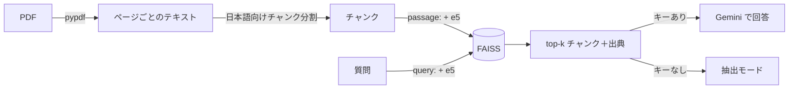

<!-- planned slug: rag-visible-sources -->

## はじめに

こんにちは、ZEN大学の通信課程で学んでいる2年生の松延です。AIエンジニアを目指して、LLMまわりの仕組みを自分の手で作りながら勉強しています。

LLMに資料のことを聞くと、たいていはそれらしい日本語で答えが返ってきます。ただ、私が気になったのは「その答え、資料のどこを見て言っているの？」という点でした。答えが正しそうに聞こえるかどうかではなく、**モデルが何を見て答えたのかがはっきりわかる**ものを作りたいと思いました。

そこで、PDFをアップロードして日本語で質問すると、**出典（ファイル名・ページ番号）付き**で答えるRAGのデモを作りました。

https://github.com/koheip/rag-doc-qa

この記事では、使い方の説明ではなく、

- 出典を正確に出すために、どこで何を決めたか
- 評価して数字を見たら、何がわかったか

を中心に書きます。セットアップの手順はREADMEにまとめているので、そちらを見てください。

## 作ったもの

Streamlitのアプリで、PDFを登録して質問すると、関連する箇所を検索して、その内容だけを根拠に答えます。回答には [1] のような番号が付き、その番号が「ファイル名 p.ページ」に対応します。検索で取り出したチャンクの本文と類似度スコアも画面で確認できます。

- 検索：`multilingual-e5-small` ＋ FAISS（`IndexFlatIP`）
- 生成：Google Gemini（公式SDK `google-genai`）。デフォルトは `gemini-3.5-flash-lite` で、サイドバーから `gemini-3.8-flash` に切り替えられます
- APIキーがなくても、検索結果をそのまま見せる「抽出モード」で動きます

処理の流れは次のとおりです。



## 決めたこと1：チャンクはページをまたがせない

出典のページ番号を正確に出すために、一番効いたのはチャンク分割の決め方でした。

チャンク分割は、ライブラリを使わずに自分で書いています。日本語は単語の間にスペースがないので、長さは**文字数**で測ります。そのうえで「。」などの**文の区切りを優先**して約200文字ずつに分け、境目で文脈が切れないよう前のチャンクの末尾を少し重ねます（オーバーラップ）。

そして、**チャンクはページをまたがないようにしました**。ページをまたぐチャンクを作ると、「このチャンクは何ページの内容か」が一つに決まらなくなります。出典を見せることが目的のアプリなので、ここは検索の都合より出典の正確さを優先しました。

自作にしたのは、日本語に合わせた分割を「中身を説明できる形」で持っておきたかったからです。ライブラリに任せると、なぜその位置で切れたのかを自分の言葉で説明しにくくなります。

## 決めたこと2：「わからない」と言わせ、使った資料だけを出典にする

生成のプロンプトでは、取り出したチャンクに番号と出典を付けて並べ、次のように指示しています（[src/llm.py](https://github.com/koheip/rag-doc-qa/blob/main/src/llm.py) より）。

```python:src/llm.py（抜粋）
SYSTEM_PROMPT = """あなたは社内ドキュメントに関する質問に答えるアシスタントです。
以下のルールを必ず守ってください。
1. 回答は【参考資料】に書かれている内容だけを根拠にしてください。あなた自身の知識で補ってはいけません。
2. 【参考資料】に答えが書かれていない場合は、推測せずに「わからない」とだけ答えてください（この場合は資料番号を付けないでください）。
3. 回答の文末には、根拠にした資料の番号を [1] [2] のように付けてください。
4. 日本語で、簡潔かつ丁寧に答えてください。"""
```

ポイントは、**検索で取り出したチャンクを全部「出典」として並べるのではなく、回答の中で実際に参照された番号だけを出典として表示する**ことです。上位4件を渡していても、答えに使ったのが1件なら、出典も1件になります。「わからない」と答えたときは出典を出しません。

温度（temperature）は0.1にしています。資料に忠実で、毎回ぶれにくい答えにしたかったからです。

## 決めたこと3：APIキーがなくても試せるようにする

APIキーがない場合は、上位のチャンクをそのまま答えとして見せる「抽出モード」で動きます。

これは「誰でもすぐ試せるように」という理由で入れましたが、作ってみると別の良さもありました。抽出モードは**検索だけの結果**なので、生成の前に「そもそも正しい箇所を拾えているか」を確かめられます。RAGがうまく答えられないとき、原因が検索にあるのか生成にあるのかを切り分けやすくなりました。

## そのほかの選択

| 項目 | 選んだもの | 理由 |
| --- | --- | --- |
| UI | Streamlit | Pythonだけで、チャットUIとファイルアップロードを短いコードで作れる |
| PDF読み込み | pypdf | 純Pythonで依存が少なく、Windows/Mac/Linuxで同じように動く |
| 埋め込み | multilingual-e5-small | 無料・ローカル実行・日本語対応。約470MBと軽く、CPUでも十分速い |
| ベクトルストア | FAISS（IndexFlatIP） | 実務で定番のライブラリの使い方を示せて、データが増えたらインデックスを差し替えられる |
| LLM | Gemini（google-genai） | 無料枠があり、公式SDKで短く呼び出せる |

E5は、文書には `passage: `、質問には `query: ` を先頭に付ける約束になっているので、それに従っています。ベクトルは384次元で、長さ1に正規化しているので、FAISSの内積がそのままコサイン類似度になります。

データ量を考えるとnumpyの行列積でも十分ですが、FAISSにしておくと、データが増えたときに総当たりの `IndexFlatIP` から近似検索のインデックスへ差し替えられます。ベクトルストアは1つのファイルに閉じ込めているので、他の部分に影響を出さずに変えられます。

## 評価してわかったこと

「なんとなく動く」で終わらせたくなかったので、検索と回答を数字で測れるようにしました。以下は2026-10-21にREADMEにまとめた結果です。

- 評価データ：同梱のサンプルPDF（架空の会社の就業規則・社内FAQ、11ページ）に対する30問
- 30問のうち、資料に答えがある質問が26問、資料に答えがない質問が4問。資料と違う言葉で聞く言い換え質問も含みます
- 検索は密ベクトル検索（e5-small、top-k=4）

### 検索：Hit@3は高いが、Hit@1はまだ低い

チャンクサイズ200文字（採用）での検索結果（回答可能な26問）は次のとおりでした。

| 指標 | 値 |
| --- | ---: |
| Hit@1 | 73.1% |
| Hit@3 | 96.2% |
| Recall@4 | 100.0% |
| MRR | 0.856 |
| 言い換え質問のHit@3 | 92.3% |

上位4件までには正解がすべて入っていますが、1位に来るのは73.1%です。正解が2〜4位に来ることが多い、ということです。

今は上位4件をまとめてLLMに渡しているので、回答には影響していません。ただ、渡す件数を減らして費用を下げたいなら、Hit@1を上げる必要があります。「回答が合っている」ことと「検索が十分に良い」ことは別だ、というのが数字を見て一番はっきりしたことでした。

### チャンクは大きければいいわけではない

チャンクサイズを150・200・300・400文字で比べたところ、200文字が最もバランスが良い結果でした。意外だったのは300文字で、言い換え質問のHit@3が**92.3%から69.2%に下がりました**。1つのチャンクに複数の条文が混ざり、ベクトルの意味がぼやけたためだと考えています。

「文脈が多いほうがよさそう」という感覚だけで決めていたら、気づけなかった点です。

### 生成：このデータセットでは差が出ない

`gemini-3.5-flash-lite`（デフォルト）では、回答可能な26問すべてに正しく答え（26/26）、資料にない4問はすべて「わからない」と正しく断りました（4/4）。応答時間はp50で0.56秒、p95で0.72秒でした。採点は、回答モデルとは別のLLMが模範解答と比べて0/1で判定する方式（LLM-as-a-judge）です。

ただ、これは「モデルが完璧」という意味ではなく、**今のデータセットが簡単すぎて上限に達している**と受け止めています。差を見るには、複数の箇所をまたぐ質問や計算が必要な質問を足す必要があります。

### この評価の限界

- 30問は少なく、1問で約4ポイント変わります
- 評価データも採点も、作者の私1人とLLM 1つによるものです
- `gemini-3.8-flash` との比較も試しましたが、評価時に高負荷（503）で応答が得られず、比較できていません

## 知っておきたい限界

作ってみてわかった、このデモの限界も書いておきます。

- **E5の類似度スコアは0.8〜0.9付近に集まりやすい**ので、「スコアが○○以下なら無関係」というしきい値は決めにくいです。そのため、資料にない質問への判断は、プロンプトでLLMに「わからない」と言わせる形にしています
- 「給料」と「給与」のような言い換えでは、正解が1位に来ないことがあります
- スキャン画像だけのPDFはOCRが必要なので未対応です
- インデックスはメモリ上にだけ持っていて、セッションが切れると消えます（デモとしてシンプルさを優先しました）

## テスト

テストはpytestで書いていて、チャンク分割・検索・LLMまわり・評価指標をカバーしています。検索のテストでは文字の出現回数で作る軽い偽の埋め込み（FakeEmbedder）、生成のテストでは偽のLLM（FakeLLM）を使うので、**モデルをダウンロードせず、APIも呼ばずに**主な流れを確認できます。

## 次にやること：ハイブリッド検索

Hit@1の改善のために、次はBM25（キーワード検索）とベクトル検索を組み合わせたハイブリッド検索に取り組みます。固有名詞や数字、条文番号などはキーワード検索のほうが得意なので、言い換えに強いベクトル検索と組み合わせる狙いです。

まだ実装はしていません。検索方式を差し替えられる形にしておき、`src/bm25.py` に実装する関数の仕様とテストを先に用意したところです。同じ30問で、Hit@1とMRRが上がるかを測るつもりです。

## まとめ

- 出典のページ番号を正確に出すため、チャンクはページをまたがせず、日本語に合わせて自分で分割した
- 回答で実際に参照した番号だけを出典として表示し、資料にないときは「わからない」と言わせた
- 評価すると、Hit@3は96.2%でもHit@1は73.1%。チャンクを300文字に広げると言い換え質問のHit@3が92.3%から69.2%に落ちた
- 「答えが合っている」ことと「検索が十分に良い」ことは別で、数字にして初めて次にやることが見えた

RAGを作るときは、答えの見た目だけでなく、「何を見て答えたか」を画面と数字の両方で確かめられるようにしておくと、改善の方向が決めやすくなると感じました。コードはすべて公開しているので、よければ触ってみてください。

https://github.com/koheip/rag-doc-qa
