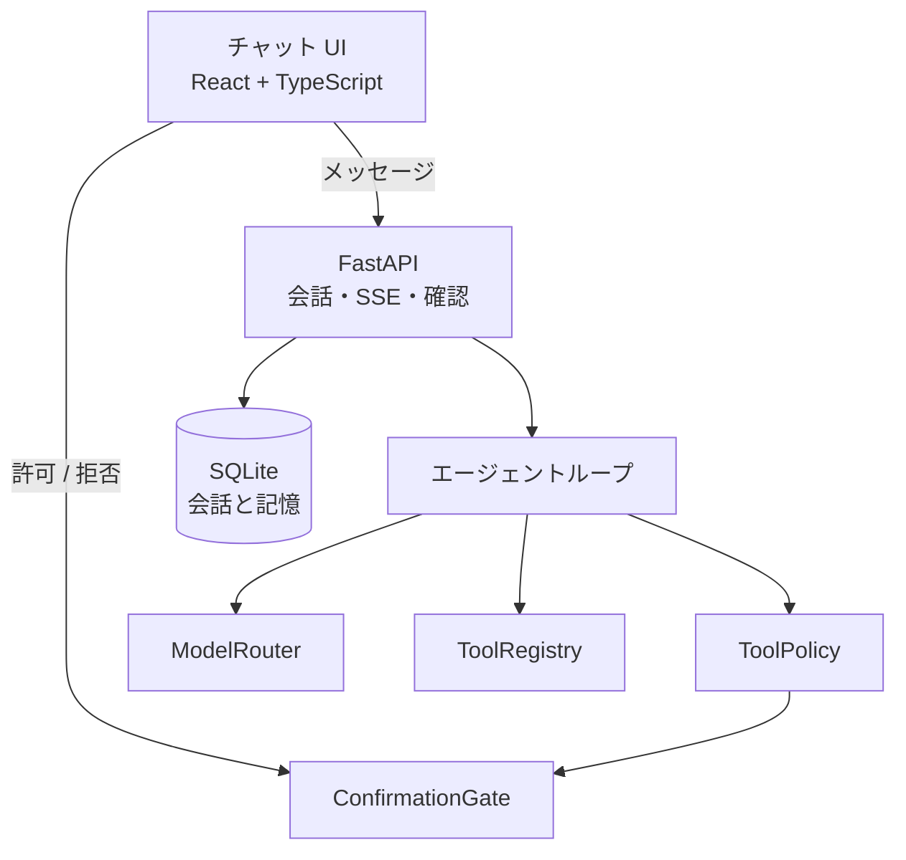

## はじめに

ZEN大学で知能情報を学んでいる2年生の松延です。AIエンジニアを目指して、AIエージェントを個人開発しています。仕事でエンジニアとして働いた経験はありません。

今回作ったのは、**ヤタ（Yata）** という、自分のPCの中で動く個人用AIアシスタントです。チャットで日本語で話しかけると、調べもの、メールや予定の確認、決まった時間の作業、日本でよく使うサービスとの連携を手伝ってくれます。会話や記録はクラウドではなく、PCの中の SQLite に残します。

先に正直に書いておくと、いまは **ベータ版** です。READMEにも「まだ作りはじめたばかりで、うまく動かないところがあるかもしれません」と書いてあります。完成した製品の報告ではなく、「こういう方針で、ここまで作った」という記録です。

コードは MIT ライセンスで公開しています。

- GitHub: [https://github.com/koheip/yata](https://github.com/koheip/yata)
- 紹介サイト: [https://koheip.github.io/yata/](https://koheip.github.io/yata/)

## なぜ作ったか

きっかけは、Grok Bot のような「自分のPCで動き、調べて、必要なときだけ手を動かし、危ないところでは止まる」アシスタントが欲しかったことです。

チャットアプリはすでにたくさんあります。自分で作る意味があるとしたら、次の3つだと考えました。

1. **データは手元に置く。** 会話や記憶を、最初から自分のPCに保存する。
2. **日本語と、日本で普段使うサービスを先にする。** Gmail やカレンダーだけでなく、LINE、Chatwork、Backlog、kintone、freee、マネーフォワード クラウド請求書、楽天市場などとつなぐ。
3. **外に出る操作の前で、必ず人に確認する。** メール送信や予定の作成を、モデルが勝手に実行しない。

名前は、神武天皇を導いたと伝わる三本足の烏「八咫烏（やたがらす）」から取りました。道を示す案内役、という役割です。マスコットは、紫色の赤ちゃんカラスです（親しみやすさを優先して、脚は2本にしています）。

最初のコミットでは「灯（Tomoshibi）」という名前でした。同じ日にヤタへ改名しています。案内役としてのイメージが、自分の中でしっくりきたからです。

ZEN大学で勉強しながら毎日使い、就職用のポートフォリオに載せ、あとから人に渡せる形にしておくこと。この3つを同時に満たす最初の版、という位置づけで作りました。

## 開発の進め方

ヤタは、Grok Bot で作りはじめて、Claude で仕上げました。私が指示を出し、AIと対話しながらコードを書いていった、という経緯です。どこをどちらが書いたか、途中で切り替えた理由までは、ここで断定できる材料がありません。いま公開しているリポジトリが、その結果です。

## ヤタでできること

READMEに書いている機能は、次のとおりです。

- **調べもの**：DuckDuckGo（`ddgs`、APIキー不要）で検索し、ページを読んで要点をまとめる
- **メールと予定**：Gmail の検索・読解・下書き作成、Google カレンダーの予定や空き時間の確認。送信や予定の作成・更新・削除は確認のあと
- **LINE から話しかける**：スマホの LINE からヤタに質問できる。確認が必要な操作には「許可する」「拒否する」ボタンが出る
- **日本のサービスと連携**：Chatwork のメッセージやタスク、Backlog の課題、kintone のレコード、freee とマネーフォワード クラウド請求書、LINE 公式アカウントのお知らせ配信、楽天市場の商品検索
- **日本の仕事の計算**：祝日・営業日・和暦、インボイス（適格請求書）の消費税。敬語の文面も書く
- **ルーティン**：「毎朝8時にニュースを要約して」と頼むと、毎日その時刻に実行する。結果を LINE に届けることもできる
- **記憶**：あなたについての短いメモを覚えて、次の会話の system プロンプトに入れる
- **ブラウザ操作**：Playwright のヘッドレス Chromium で、ページを開く・本文を取る・クリック・入力・スクリーンショット。クリックと入力は確認のあと

AIは自分で選べます。Gemini、OpenAI、Anthropic、xAI（Grok）、DeepSeek、Kimi、Mistral、Groq、OpenRouter、PLaMo のどれかの API キーを1つ用意するか、Ollama・LM Studio・llama.cpp・Jan・vLLM・LocalAI など、PCの中で動く AI を使えます。Gemini の無料枠やローカルモデルなら、料金を払わずに動かすこともできます。キーがなくても、内蔵のデモモデルでツールの流れは確認できます（回答の品質を見るためのものではありません）。

設定で **完全オフラインモード** をオンにすると、PCの中の AI だけを使い、ネット検索・ブラウザ・外部連携・LINE への通知を止めます。会話が PC の外に出ません。

## 全体の構成

バックエンドは Python 3.11 以上と FastAPI、依存管理は uv です。画面は React、TypeScript、Tailwind CSS、Vite、shadcn/ui です。エージェントループ、Playwright、SQLite を同じプロセスに置き、ビルドした UI も同じポート（既定は `http://127.0.0.1:8741`）で配ります。



1ターンの流れは、次のとおりです。モデルが考え、ツールを呼び、結果を見て、また考える。1ターンのモデル呼び出し上限は既定 8 回（`YATA_MAX_STEPS`）です。途中の `tool_call`、`confirmation_required`、`tool_result`、`answer` などは Server-Sent Events でチャットに流れます。

```mermaid
sequenceDiagram
  participant UI as チャット
  participant API as FastAPI
  participant Loop as エージェント
  participant Model as LLM
  participant Gate as 確認
  participant Tool as ツール

  UI->>API: POST /messages
  API->>Loop: 履歴 + 記憶つき system
  Loop->>Model: ツール定義つきで問い合わせ
  Model-->>Loop: tool call
  Loop-->>UI: tool_call を SSE で送る
  alt リスクが mutate / external
    Loop->>Gate: 確認を開く
    Loop-->>UI: confirmation_required
    UI->>API: 許可または拒否
    API->>Gate: resolve
  end
  Loop->>Tool: 実行
  Tool-->>Loop: 観察
  Loop-->>UI: tool_result
  Loop->>Model: 観察を渡してもう一度
  Model-->>Loop: 回答
  Loop-->>UI: answer
```

主なモジュールは次の場所にあります。

| 場所 | 役割 |
| --- | --- |
| `src/yata/agent/loop.py` | 考える、ツールを呼ぶ、観察する、答える |
| `src/yata/llm/` | プロバイダ差し替え。公式 SDK への変換は `convert.py` |
| `src/yata/tools/` | ツールの定義、登録、リスク分類 |
| `src/yata/confirm/gate.py` | 危険な操作を、UI の別リクエストで許可する |
| `src/yata/memory/store.py` | 会話と事実の SQLite |
| `src/yata/routines/` | ルーティンの保存と、APScheduler による定期実行 |
| `src/yata/connectors/` | 外部サービスとの接続と認証 |
| `src/yata/api/app.py` | HTTP と SSE。ビルド済み UI も同じポートで配信 |
| `frontend/` | 日本語のチャット画面 |

## 設計で工夫したこと

### 1. ツールにリスクを持たせ、ループは「聞くだけ」にする

ツールは名前、JSON Schema、`Risk`、`run()` を持つクラスです。新しいツールを足すときは、`tools/catalog.py` の `build_registry()` に1行登録します。リスクは4段階です。

| Risk | 意味 | 既定の扱い |
| --- | --- | --- |
| `read` | 検索、ページ読解、スクリーンショット、Gmail / カレンダーの参照 | すぐ実行 |
| `write` | ローカルな記憶の保存、Gmail の下書き作成 | すぐ実行 |
| `mutate` | ブラウザのクリックと入力 | 確認してから |
| `external` | メール送信、予定の作成・更新・削除、メッセージ送信、経費の登録など | 確認してから |

エージェントループは、ツールごとの特別扱いを書きません。`ToolPolicy` に「確認が要るか」を聞くだけです。

```python
CONFIRM_RISKS = {Risk.MUTATE, Risk.EXTERNAL}

class ToolPolicy:
    def needs_confirmation(self, tool: Tool, arguments: dict) -> bool:
        del arguments
        return tool.risk in CONFIRM_RISKS
```

確認が必要なときは、先に画面へ `confirmation_required` を送り、許可が出るまで待ちます。拒否やタイムアウトは実行しません。

```python
if policy.needs_confirmation(tool, call.arguments):
    request_id = gate.open()
    yield AgentEvent(
        "confirmation_required",
        {
            "request_id": request_id,
            "tool": tool.name,
            "risk": tool.risk.value,
            "summary": describe_action(tool, call.arguments),
            "arguments": call.arguments,
        },
    )
    approved = await gate.wait(request_id, confirm_timeout)
    if not approved:
        # 「ユーザーがこの操作を拒否したか、確認がタイムアウトしました。」
        return
result = await tool.run(call.arguments, ctx)
```

確認ゲートの実体は、プロセスのメモリ上の `asyncio.Future` です。エージェントのループと、画面（または LINE）からの許可リクエストを、同じ Future でつないでいます。時間切れは拒否に倒しています。迷ったら実行しない、という方針です。

ただし、ゲートはメモリ上にあるので、サーバーを落とすと待ちの確認は消えます。ここは、まだ粗いところです。

未接続の連携のツールは、モデルに見せません（`visible_registry()`）。キーがまだなくてもアプリは起動し、そのツールが見えないだけです。

### 2. 統一ラッパーを使わず、公式SDKで差を見えるところに置く

モデルの差し替えには LiteLLM のような単一ラッパーも候補でした。この版では公式 SDK（`google-genai`、`openai`、`anthropic`）を選んでいます。プロバイダのインターフェースは `complete(messages, tools, model)` だけです。

各社の違い、とくにツール結果の形の違い（OpenAI は `tool` ロール、Anthropic は `tool_result` ブロック、Gemini は `function_response` パート）は `llm/convert.py` に残しています。ラッパーを使えばコードは減りますが、依存が増え、変換の場所が見えにくくなります。学習とポートフォリオを兼ねた個人開発なので、違いが読める方を選びました。

Ollama、LM Studio、vLLM など OpenAI 互換のサーバーは、同じ OpenAI アダプタの `base_url` を変えるだけです。キーが無いプロバイダは一覧で「利用不可」になり、送信前に API が拒否します。

小さいローカルモデル向けには、通常より短い system プロンプト（`COMPACT_PROMPT`）を使うようにしています。長い指示だと、小さいモデルは話の筋を見失いやすい、という判断です。ブラウザ操作のツールも、既定ではローカルモデルには渡しません（`YATA_LOCAL_BROWSER_TOOLS`）。

### 3. 外に出る入口を、できるだけ小さくする

ページを読むときは、リダイレクトのたびに URL を検査します。クラウドのメタデータアドレス（`169.254.169.254` と `metadata.google.internal`）は常に拒否します。プライベートアドレスは `YATA_ALLOW_PRIVATE_URLS` で切り替え、個人利用の既定は `true`、公開するときは `false` にします。

LINE の Webhook は、メイン画面（8741番）とは別のサーバーで、`127.0.0.1:8742` の `/line/webhook` と `/line/health` だけを提供します。署名検証と userId の許可リストで受信を制限します。トンネルで公開するのはこの Webhook だけです。チャット画面そのものは外に出しません。

cloudflared の quick tunnel は、起動のたびに URL が変わります。ヤタはトンネルを自動で立ち上げ、URL が変わるたびに LINE 側の Webhook URL を登録し直します。止めたいときは `YATA_LINE_TUNNEL=false` にして、手動で用意することもできます。

### 4. ルーティンは同じプロセスの中で動かす

「毎朝8時にニュースを要約して」のようにチャットで頼むか、サイドバーから追加すると、同じプロセスの APScheduler がエージェントループを呼びます。時刻の既定タイムゾーンは `Asia/Tokyo` です。

ブラウザのタブを閉じても、ヤタのプロセスが生きていれば実行され、結果はルーティン専用の会話に残ります。危険なツールは、誰も見ていないときは「確認待ち」になり、開いたときに許可か拒否を聞きます。ルーティンごとの「LINE通知」をオンにした場合の通知は、利用者が設定したものとして、実行ごとの確認なしで自分の LINE に送ります。

いまは、ターミナルを閉じたあとも生かす Windows サービスや、OS の通知はありません。サーバーを起動したままにしておく必要があります。ここはロードマップの先の段階です。

## つまずいたこと、まだ粗いところ

いちばん大変だったのは、機能そのものより **最初の接続** です。Gmail やカレンダーは、Google Cloud Console で API を有効にし、OAuth 同意画面を作り、デスクトップアプリのクライアント ID を用意し、テストユーザーに自分を追加する、という手順があります。LINE も、公式アカウントと Messaging API、許可する userId、トンネルが必要です。連携を足すほど、自分でも使うまでの道のりが長くなりました。

ほかにも、ベータとして残している点があります。

- 確認ゲートはプロセスのメモリ上なので、再起動すると待ちの確認は消える
- ブラウザのログイン状態は、再起動すると残らない（会話ごとに1ページのヘッドレス Chromium）
- ルーティンを動かし続けるには、ヤタのプロセスを起動したままにする必要がある
- PC全体のマウス操作などのデスクトップ制御は、まだ実装していない
- README用のスクリーンショットやデモGIFは、置く場所だけ用意して、まだ入っていない
- Microsoft Store への掲載は、紹介サイトでも「準備中」としている。GitHub Releases には v0.1.0 の `Yata-Setup-0.1.0.exe` と MSIX がある。Setup.exe はコード署名がないため、「Windows によって PC が保護されました」と出ることがある（「詳細情報」→「実行」で入る）

テストは `uv run pytest` で、ネットワークも API キーも使いません。エージェントループ、確認の前後、プロバイダ変換、記憶、ルーティン、各連携などを、モックを使って確認しています。

## 動かし方（Windows）

ソースから動かす場合は、[uv](https://docs.astral.sh/uv/) と Node.js（READMEでは 22 前後）と Git が入っていれば、PowerShell で次の1行です。足りないものがあれば、スクリプトが入れ方を案内します（勝手にはインストールしません）。

```powershell
git clone https://github.com/koheip/yata.git; cd yata; powershell -ExecutionPolicy Bypass -File scripts\install.ps1
```

準備ができたら `uv run yata` で起動します。はじめて開くと「AI をつなぎましょう」という案内が出るので、画面の手順どおりに API キーを貼り付けてください。専用ウィンドウが開かないときは、http://127.0.0.1:8741 をブラウザで開きます。

開発者向けには、`./scripts/run.sh` でも起動できます。ブラウザ操作を使うときは `uv run playwright install chromium` が必要です。未インストールでも、検索・読解・記憶は動きます。

インストーラーは GitHub の [Releases](https://github.com/koheip/yata/releases) から入手できます。アプリ版のデータは `%LOCALAPPDATA%\Yata` に保存されます。

## これから

ロードマップでは、いまあるのは土台（エージェントループ、ツール、確認、記憶）と、プロセス内のルーティン、そして Gmail / カレンダーを含む連携までです。その先には、トレイや自動起動、OS通知を持つデスクトップアプリ化、PCの電源が切れていてもルーティンが動くホスト版、などを書いている段階です。計画にある機能を、実装済みとしては扱いません。

まずは、自分で毎日使って、設定の手間を減らし、粗いところを直していきたいです。不具合や要望は、GitHub の Issues で教えてもらえると助かります。

- GitHub: [https://github.com/koheip/yata](https://github.com/koheip/yata)
- 紹介サイト: [https://koheip.github.io/yata/](https://koheip.github.io/yata/)
- 最新リリース: [https://github.com/koheip/yata/releases/tag/v0.1.0](https://github.com/koheip/yata/releases/tag/v0.1.0)
